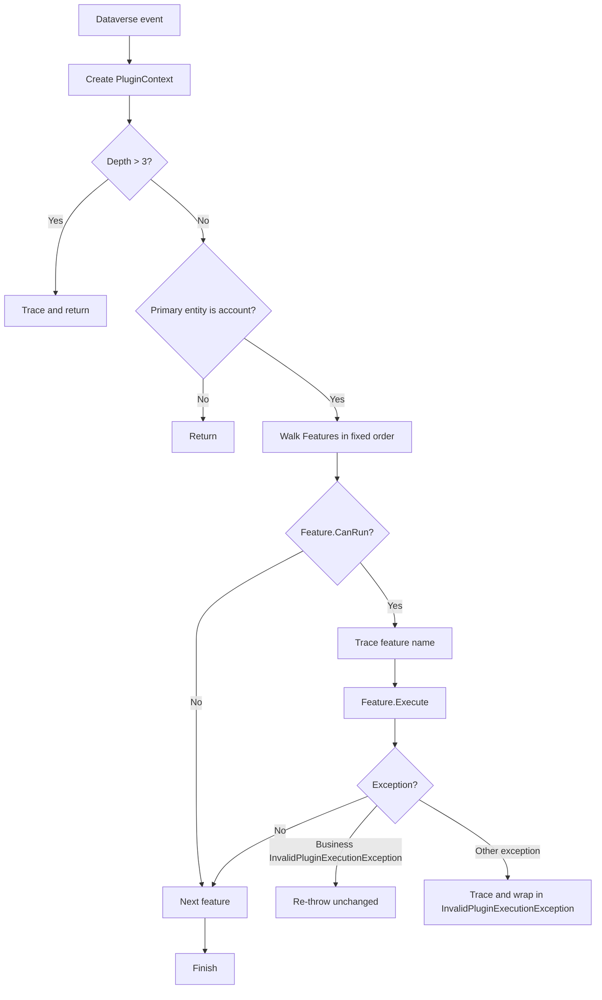

# MyCompany.Plugins — Complete Code Logic and Processing Guide

## 1. Purpose and scope

`MyCompany.Plugins` is a signed .NET Framework 4.7.2 class library for Microsoft Dataverse / Dynamics 365. The project implements account-related business rules, data normalization, duplicate prevention, generated account numbers, follow-up work, change auditing, deactivation cascading, delete protection, and source tagging.

This document describes the behavior implemented in the repository. It does not invent Plugin Registration Tool steps: the source code assumes registrations, images, privileges, and field filtering that must be configured in Dataverse.

## 2. Repository and project structure

```text
MyCompany.Plugins.slnx
└── MyCompany.Plugins
    ├── MyCompany.Plugins.csproj
    ├── AccountPlugin.cs
    ├── Account.snk
    ├── app.config
    ├── packages.config
    ├── ARCHITECTURE.md
    ├── Core
    │   ├── Extensions.cs
    │   ├── IPluginFeature.cs
    │   └── PluginContext.cs
    └── Features
        ├── AccountNumberFeature.cs
        ├── AccountSourceTagPlugin.cs
        ├── AccountValidationFeature.cs
        ├── ChangeAuditFeature.cs
        ├── DeactivationCascadeFeature.cs
        ├── DeleteGuardFeature.cs
        ├── DuplicateAccountFeature.cs
        ├── FollowUpTaskFeature.cs
        └── NormalizationFeature.cs
```

### Project and build files

- `MyCompany.Plugins.slnx` contains one project and marks the solution as CRM-bound.
- `MyCompany.Plugins.csproj` builds a library named `MyCompany.Plugins`, targets .NET Framework 4.7.2, compiles all files under `Core` and `Features`, and compiles `AccountPlugin.cs`.
- The assembly is strong-name signed using `Account.snk`. The key is a binary signing artifact and is not represented in this document.
- Debug builds emit full symbols without optimization. Release builds optimize and emit PDB-only symbols. Both use `AnyCPU` by default.
- `app.config` redirects `System.Runtime.CompilerServices.Unsafe` versions from `0.0.0.0–6.0.0.0` to `6.0.0.0`.
- `packages.config` restores the Dataverse SDK 9.0.2.60 and supporting .NET Framework packages. The direct CRM references are `Microsoft.Xrm.Sdk` and `Microsoft.Crm.Sdk.Proxy`.
- `.gitignore` excludes Visual Studio state, build output, packages, logs, test results, and other generated files.

## 3. Runtime architecture

There are two plugin entry points:

1. `AccountPlugin` is the main dispatcher. It owns an ordered array of stateless `IPluginFeature` objects and runs the features whose message and stage match the current pipeline event.
2. `AccountSourceTagPlugin` is an independent `IPlugin` implementation. It is not in the `AccountPlugin.Features` array and must be registered separately if source tagging is required.

The main dispatcher follows this process:



### `AccountPlugin.Execute`

1. Creates a `PluginContext` from the supplied `IServiceProvider`.
2. Traces message, numeric stage, depth, and user ID.
3. Stops when `Depth` is greater than `3`, preventing unbounded recursion from plugin-created records or updates.
4. Stops when `PrimaryEntityName` is not `account` (case-insensitive).
5. Iterates the following array in order:

| Order | Feature | Intended message/stage |
|---:|---|---|
| 1 | `AccountValidationFeature` | Create/Update, PreValidation |
| 2 | `DuplicateAccountFeature` | Create/Update, PreValidation |
| 3 | `NormalizationFeature` | Create/Update, PreOperation |
| 4 | `AccountNumberFeature` | Create, PreOperation |
| 5 | `FollowUpTaskFeature` | Create, PostOperation |
| 6 | `ChangeAuditFeature` | Update, PostOperation |
| 7 | `DeactivationCascadeFeature` | Update/SetState, PostOperation |
| 8 | `DeleteGuardFeature` | Delete, PreValidation |

6. Calls `CanRun`; a false result skips the feature.
7. Traces and executes matching features.
8. Re-throws `InvalidPluginExecutionException` unchanged so business messages reach the user.
9. Traces all other exceptions and wraps them in a new `InvalidPluginExecutionException` containing the feature name and original message.

The array order matters when multiple features match one invocation. For example, validation and duplicate checking happen before PreOperation normalization; normalization happens before account number generation; and update post-operation auditing is evaluated before deactivation cascading.

## 4. Core infrastructure

### `IPluginFeature` and `PluginStage`

`PluginStage` maps Dataverse stages to readable values:

- `10` — PreValidation
- `20` — PreOperation
- `40` — PostOperation

Each feature exposes a display `Name`, a `CanRun(PluginContext)` gate, and an `Execute(PluginContext)` method. Feature instances are held in a static array, so they must remain stateless. All request-specific state must come from `PluginContext` or local variables.

### `PluginContext`

`PluginContext` wraps the Dataverse service provider and lazily creates services:

- `Tracing` — `ITracingService` for Plugin Trace Log diagnostics.
- `Execution` — `IPluginExecutionContext` for message, stage, entity, parameters, images, depth, and user IDs.
- `UserService` — organization service created with `Execution.UserId`; it runs with the calling user’s permissions.
- `SystemService` — organization service created with `null`; it runs as SYSTEM and is used for housekeeping that the caller may not be allowed to perform.

Convenience properties expose message name, stage, primary entity, primary ID, depth, user ID, and initiating user ID. `Target` reads the `Target` input parameter and returns an `Entity`, or null when the parameter is absent or not an entity. This is expected for Delete, where the target is normally not available as an entity.

`PreImage` reads the pre-image with the exact alias `PreImage`. `ChangeAuditFeature` depends on that alias. `Is(message, stage)` performs a case-insensitive message comparison and an exact stage comparison. `Trace` handles both a format string with arguments and a plain string.

### `Extensions`

- `IsBlank` uses `string.IsNullOrWhiteSpace`.
- `GetTrimmed` reads a string attribute and returns its trimmed value, preserving null.
- `Exists` changes a `QueryExpression` to `TopCount = 1`, retrieves records, and returns whether at least one exists.
- `RetrieveAll` retrieves pages of up to 500 records, follows `MoreRecords` and `PagingCookie`, and returns all records. The query object is modified with paging state.

## 5. Feature logic

### 5.1 Account validation — `AccountValidationFeature`

**Runs:** Create or Update at PreValidation.

The feature gathers every validation error before throwing, so the user receives one combined message. On Create, account name is required. On Update, name is checked only when included in the partial target. The following rules apply:

- Name is trimmed, must not be blank, and cannot exceed 160 characters.
- `emailaddress1`, when supplied and nonblank, must match the simple pattern `non-whitespace@non-whitespace.non-whitespace`.
- `telephone1`, when supplied and nonblank, must contain 7–15 digits. Formatting characters are allowed because only digit count is measured.
- `websiteurl`, when supplied and nonblank, is parsed as HTTP or HTTPS. If no scheme is present, `https://` is prepended. A host containing a period is required.
- `creditlimit` and `revenue` cannot be negative.
- `numberofemployees`, when supplied, cannot be negative.

A failure throws `InvalidPluginExecutionException` with a bullet list. It does not update the target.

### 5.2 Duplicate account check — `DuplicateAccountFeature`

**Runs:** Create at PreValidation, or Update at PreValidation only when `name` is in the target.

The name is trimmed. A blank name is ignored here because the validation feature owns the required-name message. A SYSTEM query searches active accounts (`statecode = 0`) with an exact name match. On Update, the current account ID is excluded. The query returns at most one record and requests `accountnumber` so the error can include it when present.

When a duplicate exists, execution stops with a message such as `An active account named 'X' already exists (ACC-...)`. The check uses SYSTEM so it can see records the caller cannot read. As with all pre-query duplicate checks, true database-level uniqueness would require an additional uniqueness strategy to remove race conditions between simultaneous requests.

### 5.3 Data normalization — `NormalizationFeature`

**Runs:** Create or Update at PreOperation.

Because it runs before persistence, it edits `Target` directly. For each string attribute, null is ignored; whitespace is trimmed; an empty result becomes null.

- `name`: collapses consecutive whitespace to one space.
- `emailaddress1`: converts to lowercase using invariant casing.
- `telephone1`: collapses consecutive whitespace to one space.
- `websiteurl`: adds `https://` when no scheme is present.
- `accountnumber`: converts to uppercase invariantly.

The ordering in `AccountPlugin` means validation and duplicate checking see the original target values, while later save-time values are normalized. This is important when callers provide leading/trailing whitespace or mixed casing.

### 5.4 Account number generation — `AccountNumberFeature`

**Runs:** Create at PreOperation.

If the target is present and `accountnumber` is blank, the feature tries up to five times to generate:

```text
ACC-yyyyMMdd-XXXXXX
```

The date is UTC and the six-character suffix is derived from a new GUID, uppercased. Each candidate is checked against existing account numbers using the SYSTEM service and a `TopCount = 1` query. The first unused candidate is assigned directly to the target. If all five candidates appear occupied, the feature throws a user-facing `InvalidPluginExecutionException`.

This is a best-effort collision check, not a transactional uniqueness guarantee. The normalization feature runs immediately before it and uppercases any caller-supplied account number, but the generator itself is only used when the supplied value is blank.

### 5.5 Follow-up task — `FollowUpTaskFeature`

**Runs:** Create at PostOperation.

If a target exists, it creates a task related to the new account. The task:

- Uses `Follow up with new account: <name>` as subject, or `(unnamed)` when name is missing.
- Includes a fixed introduction/contact-details description.
- Is scheduled for three UTC days after execution.
- Uses priority option value `1` (Normal).
- Regards the created account.
- Is owned by the account’s `ownerid`, or by the executing user when no owner is present.

The task is created through `SystemService` because the creating user may not have Task create privileges. The task ID is traced.

### 5.6 Change audit — `ChangeAuditFeature`

**Runs:** Update at PostOperation.

The feature requires a pre-image with alias `PreImage`. If the target or image is missing, it safely returns; a missing image is traced as `PreImage not registered - audit skipped.` It examines only fields included in the Update target, comparing them with the same fields in the pre-image:

- `name`
- `telephone1`
- `emailaddress1`
- `websiteurl`
- `creditlimit`
- `revenue`
- `primarycontactid`
- `ownerid`
- `statecode`

Blank strings are treated as null. Entity references compare by ID, Money values by numeric value, and option sets by integer value. Other values use normal equality. If nothing changed, no note is created.

When changes exist, the feature creates an `annotation` related to the account through SYSTEM. The subject is `Audit: account fields changed`; the body includes the initiating user’s full name (or ID fallback), UTC timestamp, and one `old -> new` line per changed field. Money values use invariant `N2` formatting, empty values display as `(empty)`, references display their name or `logicalname:ID`, and `statecode` option values display as Active for `0` and Inactive for other values.

The initiating user lookup is protected by a broad catch; if it fails, auditing still proceeds using the user ID.

### 5.7 Deactivation cascade — `DeactivationCascadeFeature`

**Runs:** Update at PostOperation when the target contains inactive `statecode`; or `SetState` / `SetStateDynamicEntity` at PostOperation when the `State` input is inactive (`OptionSetValue = 1`).

The feature queries all open tasks related to the account (`regardingobjectid`, `statecode = 0`) using SYSTEM and retrieves every page. It cancels at most 200 tasks in the current synchronous run. Each cancellation uses `SetStateRequest` with task state `2` and status `6`, both representing Canceled for the expected Dataverse task metadata. It traces both the canceled count and total open count.

Tasks above the 200-record cap remain open. The cap exists to keep synchronous execution within the two-minute platform limit.

### 5.8 Delete guard — `DeleteGuardFeature`

**Runs:** Delete at PreValidation.

It checks, through SYSTEM, whether the account has:

- An open opportunity using `parentaccountid` and `statecode = 0`.
- An active case (`incident`) using `customerid` and `statecode = 0`.

If either exists, it throws a single message listing `open opportunities` and/or `active cases`, instructing the user to close or reassign them. Both checks use existence queries and stop after the first matching record.

### 5.9 Account source tagging — `AccountSourceTagPlugin`

This class is independent of `AccountPlugin` and has its own depth and account/Create checks. It only acts at stage 20 or 40:

#### PreOperation decision step

`SetContextFromTag` traces stage, mode, depth, initiating user, executing user, target attribute names, current shared variables, and whether a parent context exists. It tries to find shared variable `tag`, walking the current context and all `ParentContext` objects.

If no shared `tag` exists, it derives:

- `Import` when the Create target contains a non-null `importsequencenumber`.
- `Direct` otherwise.

It publishes the result as shared variable `MyCompany.Source`. For `Migration` or `Batch` (case-insensitive), it publishes `MyCompany.SkipFollowUp = true` and traces that the follow-up note will be skipped.

Important: despite the helper name and comments, this class does not read a `tag` attribute from the account target. It reads a shared variable named `tag`, then falls back to import detection or `Direct`.

#### PostOperation action step

`ActOnContext` again walks the current and parent contexts. If `MyCompany.Source` is missing, it traces that the PreOperation step may not be registered and returns. If `MyCompany.SkipFollowUp` is present, it traces and returns.

Otherwise, it creates an `annotation` with:

- Subject `Account created via <source>`.
- Text `Source tag: <source>`.
- `objectid` pointing to the created account.
- `objecttypecode` set to `account`.

It uses a service created for `context.UserId`, not SYSTEM. It then updates the account description to `AccountSourceTagPlugin ran. Source: <source>` and traces both operations.

The source plugin’s action is therefore an annotation plus an account description update. It does not create the follow-up task created by `FollowUpTaskFeature`; the source plugin’s `SkipKey` controls only its own annotation/update action. Registering both plugins can cause both independent post-create behaviors.

## 6. End-to-end processing by operation

### Create

```text
Create request
  └─ PreValidation
       ├─ AccountValidationFeature: validate submitted fields
       └─ DuplicateAccountFeature: reject active duplicate name
  └─ PreOperation
       ├─ NormalizationFeature: edit Target values before save
       ├─ AccountNumberFeature: assign generated number when blank
       └─ AccountSourceTagPlugin (if separately registered): publish source
  └─ Core platform save
  └─ PostOperation
       ├─ FollowUpTaskFeature: create owner task through SYSTEM
       └─ AccountSourceTagPlugin (if separately registered): create source annotation/update description
```

Validation and duplicate checking occur before normalization, so the exact comparison input is the submitted value. The account number is generated after normalization and becomes part of the create target.

### Update

```text
Update request
  └─ PreValidation
       ├─ AccountValidationFeature: validate only changed fields, plus name rules
       └─ DuplicateAccountFeature: check only when name changed
  └─ PreOperation
       └─ NormalizationFeature: normalize changed string values
  └─ Core platform save
  └─ PostOperation
       ├─ ChangeAuditFeature: compare Target with PreImage and write audit note
       └─ DeactivationCascadeFeature: if state changed to inactive, cancel open tasks
```

The audit feature only sees fields included in the partial Update target. A complete pre-image is required for reliable before-values, even though only the monitored attributes are needed by the audit logic.

### SetState / SetStateDynamicEntity

```text
SetState request
  └─ PostOperation
       └─ DeactivationCascadeFeature: when State = inactive, cancel open tasks
```

The main `AccountPlugin` entity guard still requires the primary entity to be account. No validation, normalization, audit, or delete feature applies to SetState.

### Delete

```text
Delete request
  └─ PreValidation
       └─ DeleteGuardFeature: block when open opportunities or active cases exist
```

The Delete target is not required because the feature uses the primary entity ID and SYSTEM queries.

## 7. Required Dataverse registration and permissions

The source code requires registration equivalent to the following logical steps. Exact filtering attributes and execution mode are deployment decisions, but the message/stage/entity combinations must match the gates.

| Plugin type | Message | Primary entity | Stage | Required setup |
|---|---|---|---:|---|
| `AccountPlugin` | Create | account | 10 | Target available; validation and duplicate check |
| `AccountPlugin` | Update | account | 10 | Target available; validation and duplicate check |
| `AccountPlugin` | Create | account | 20 | Target available; normalization and number generation |
| `AccountPlugin` | Update | account | 20 | Target available; normalization |
| `AccountPlugin` | Create | account | 40 | Primary ID and target; follow-up task |
| `AccountPlugin` | Update | account | 40 | Pre-image alias `PreImage` containing monitored fields |
| `AccountPlugin` | SetState | account | 40 | State input; deactivation cascade |
| `AccountPlugin` | SetStateDynamicEntity | account | 40 | State input where this message is used |
| `AccountPlugin` | Delete | account | 10 | Primary ID; delete guard |
| `AccountSourceTagPlugin` | Create | account | 20 | Same pipeline/shared-variable scope as its post step |
| `AccountSourceTagPlugin` | Create | account | 40 | Reads source variables and performs annotation/update |

Registering `AccountSourceTagPlugin` only at PostOperation produces the traced no-source path. Registering only at PreOperation publishes a decision but never performs the action.

The assembly’s SYSTEM operations require the runtime/plugin account to be able to query and mutate the involved Dataverse tables. The source plugin’s post-operation annotation and account update use the calling user’s permissions, so that user needs Annotation create and Account update privileges. Account creation also needs the permissions required by the core platform operation.

For `ChangeAuditFeature`, configure a pre-image named exactly `PreImage` and include at least the monitored fields. For source tagging, ensure shared variables are placed in a context visible to the plugin step; the implementation explicitly searches parent contexts but does not read an account `tag` attribute.

## 8. Error handling, tracing, and recursion

- Business-rule failures use `InvalidPluginExecutionException` and are re-thrown unchanged by `AccountPlugin`.
- Unexpected feature failures are traced with the feature name and wrapped in `InvalidPluginExecutionException`.
- AccountPlugin and AccountSourceTagPlugin both stop when depth exceeds 3. The condition is `> 3`, so depth 3 still runs.
- Trace output is essential for diagnosing missing images, missing shared variables, skipped stages, generated numbers, canceled tasks, and feature failures.
- Post-operation features create tasks, notes, or updates. These operations can trigger additional Dataverse pipeline executions; the depth guard limits recursive re-entry but does not eliminate all side effects.

## 9. Build and deployment process

1. Restore the packages listed in `packages.config`.
2. Build the `MyCompany.Plugins.csproj` project for Debug or Release.
3. Verify that the strong-name signature uses `Account.snk` and that the resulting assembly version/public key is the version intended for the target environment.
4. Register the signed assembly with the Plugin Registration Tool or the organization’s supported deployment process.
5. Register the message/stage/entity steps and the `PreImage` described above.
6. Grant the required privileges to the SYSTEM/plugin execution context and calling users.
7. Enable plugin tracing in the target environment when validating behavior.
8. Test Create, Update, deactivation through both Update and SetState paths, Delete, import-created accounts, and Migration/Batch source values.
9. Package the registered assembly and steps in the appropriate Dataverse solution for promotion between environments.

## 10. Operational considerations and limitations

- Duplicate name and generated account-number checks are pre-flight queries; concurrent requests can still race unless the environment adds a database/platform uniqueness mechanism.
- Validation and duplicate checking happen before normalization. If business rules require case-insensitive or whitespace-insensitive duplicate detection, the query logic must be changed or normalization must occur earlier.
- Deactivation cancels only the first 200 open related tasks. The trace reports any remainder.
- `ChangeAuditFeature` skips auditing if the required image is absent, rather than failing the update.
- The source plugin writes its annotation/update as the calling user, while most housekeeping features use SYSTEM. This intentionally creates different privilege requirements.
- The source plugin’s comments refer to a follow-up note, but the implementation creates an annotation and updates description; `FollowUpTaskFeature` separately creates a task.
- The code assumes standard Dataverse logical names and option values: account, task, opportunity, incident, annotation; active/open state `0`; inactive account state `1`; canceled task state/status `2`/`6`.
- No test project or test files are included in the project inventory. Validation should therefore include integration tests against a Dataverse environment or suitable SDK fakes before production deployment.
