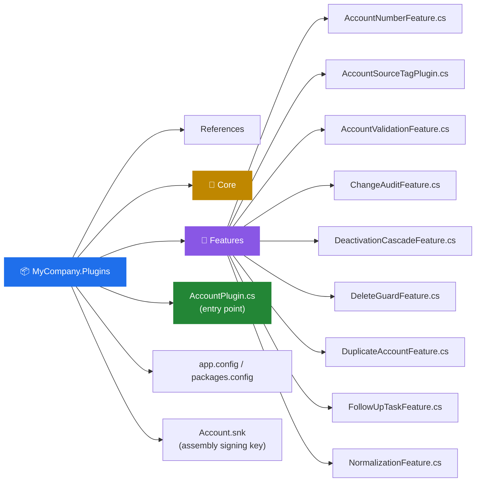
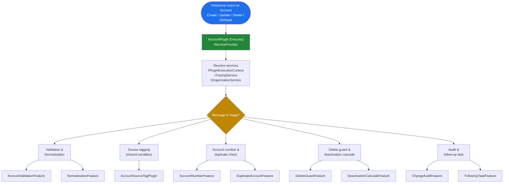
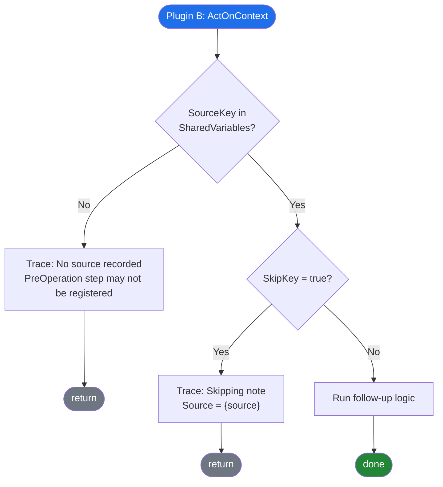
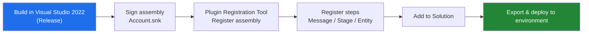

# MyCompany.Plugins – Architecture & Flow

A Dataverse / Dynamics 365 C# plugin library (.NET Framework class library) that bundles several account-related features behind a single plugin entry point.

> GitHub renders the Mermaid diagrams below automatically.

---

## 1. Project Structure



---

## 2. High-Level Execution Flow

One registered plugin class (`AccountPlugin`) receives the Dataverse event and dispatches to the individual feature classes.



> ⚠️ The message/stage grouping above is a logical overview. Adjust it to match your actual plugin step registrations.

---

## 3. Cross-Step Communication (Shared Variables)

`AccountSourceTagPlugin` is split into two cooperating steps. **Plugin A** records information in `context.SharedVariables`; **Plugin B** reads it later in the same pipeline and decides what to do.

```mermaid
sequenceDiagram
    autonumber
    participant DV as Dataverse Pipeline
    participant A as Plugin A<br/>SetContextFromTag (PreOperation)
    participant SV as context.SharedVariables
    participant B as Plugin B<br/>ActOnContext
    participant F as FollowUpTaskFeature

    DV->>A: Execute (PreOperation)
    A->>A: Read tag from record
    A->>SV: SharedVariables[SourceKey] = tag
    alt tag is "Migration" or "Batch"
        A->>SV: SharedVariables[SkipKey] = true
        A->>A: trace "Follow-up note will be skipped"
    end

    DV->>B: Execute (later stage)
    B->>SV: TryGetShared(SourceKey)
    alt source not found
        B->>B: trace "No source recorded; PreOperation step may not be registered."
        B-->>DV: return
    else source found
        B->>SV: TryGetShared(SkipKey)
        alt skip == true
            B->>B: trace "Skipping note. Source = {source}"
            B-->>DV: return
        else skip not set
            B->>F: Create follow-up note/task
        end
    end
```

### Decision logic (flowchart view)



---

## 4. Feature Reference

| Feature class | Purpose |
|---|---|
| `AccountNumberFeature` | Account number generation / handling |
| `AccountSourceTagPlugin` | Tags the request source (e.g. Migration, Batch) and shares it across pipeline steps |
| `AccountValidationFeature` | Field / business-rule validation |
| `ChangeAuditFeature` | Tracks changes made to the account |
| `DeactivationCascadeFeature` | Cascades actions when an account is deactivated |
| `DeleteGuardFeature` | Prevents deletion under defined conditions |
| `DuplicateAccountFeature` | Duplicate account detection |
| `FollowUpTaskFeature` | Creates follow-up note/task (skipped for Migration / Batch sources) |
| `NormalizationFeature` | Cleans / standardizes field values |

---

## 5. Build & Deploy



---

## Notes

- Keep PreOperation and later-stage steps registered together, otherwise Plugin B logs "No source recorded."
- Always use `ITracingService` so behavior can be diagnosed from the Plugin Trace Log.
- Do not commit secrets, connection strings, or `bin/` / `obj/` folders (add them to `.gitignore`).
